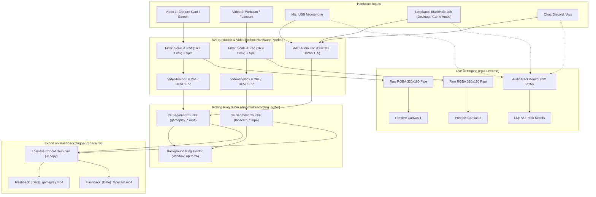

# MultiRecording (Rust / macOS)

[](https://www.rust-lang.org/)
[](https://apple.com)
[](LICENSE)
[]()

A high-performance macOS desktop application built in 100% Rust for content creators, streamers, and gamers. MultiRecording captures multiple simultaneous video feeds (e.g. 4K capture card gameplay + webcam facecam) and up to 5 discrete audio tracks (mic, game sound, Discord, speaker output), maintaining a continuous **retroactive flashback buffer** (up to 2 hours) backed by Apple Silicon hardware acceleration (`VideoToolbox`). At any moment, hit **Save Flashback** (`Space` or `F`) to instantly export the last $N$ minutes losslessly without re-encoding.

---

## Table of Contents

- [Key Features](#key-features)
- [System Architecture](#system-architecture)
- [Project & Code Structure](#project--code-structure)
- [Quick Start](#quick-start)
  - [Prerequisites](#prerequisites)
  - [Running the GUI](#running-the-gui)
  - [Running Headless / CLI](#running-headless--cli)
  - [Discovering Devices](#discovering-devices)
- [Audio Routing & Loopback (Speakers / AirPods)](#audio-routing--loopback-speakers--airpods)
- [Configuration Guide (`config.toml`)](#configuration-guide-configtoml)
- [NLE Multicam Workflow (Premiere Pro / DaVinci Resolve)](#nle-multicam-workflow-premiere-pro--davinci-resolve)
- [Testing Suite](#testing-suite)

---

## Key Features

- **Multi-Source Video Capture**: Concurrently record independent video inputs (e.g. Elgato 4K capture card, internal screen, external webcam, or capture dongle) perfectly synchronized.
- **Accurate Canvas Resolution Probing**: Automatically detects native Retina display resolutions (e.g. `3024x1964 60fps`) and live hardware webcam parameters directly from AVFoundation.
- **Interactive Output Resolution Selectors**: Choose individual target resolutions per stream directly from the UI dropdown: `1080p 60fps`, `1440p 60fps`, `4K 60fps`, `720p 60fps`, `1080p 30fps`, or `Native Input`.
- **Up to 5 Discrete Multi-Track Audio Channels**: Simultaneously record isolated audio tracks (e.g., Track 1: Game, Track 2: Mic, Track 3: Discord, Track 4: Speakers, Track 5: Aux).
- **Embedded Track Labels**: Custom track titles are embedded directly into MP4/MOV container metadata (`title=Game Audio`, `title=Microphone`) so Premiere Pro & DaVinci Resolve timelines automatically label tracks upon import.
- **Live Hardware Audio VU Meters**: Real-time decibel meters powered by an internal AVFoundation PCM audio sampler reading live float samples from active audio hardware.
- **Speaker & AirPods Capture**: Built-in support for macOS CoreAudio output recording via the BlackHole loopback driver.
- **Zero-CPU Hardware Acceleration**: Leverages Apple Silicon's dedicated media engines via `h264_videotoolbox` and `hevc_videotoolbox` (H.265).
- **Sub-Second Lossless Flashback Remuxing**: Maintains a rolling ring buffer (from 1 minute up to 2 hours) in fast temporary storage. Pressing `Space` or `F` stitches the buffer losslessly using FFmpeg concat stream copy (`-c copy`) in ~2 seconds.
- **Comprehensive Settings Drawer**:
  - Container format selection: **MP4** (`.mp4`), **QuickTime** (`.mov`), or **Matroska** (`.mkv`).
  - Output folder selection with native macOS Finder folder browser (`📂 Browse...`) and reveal.
  - Video encoder toggles (`h264_videotoolbox`, `hevc_videotoolbox`, `libx264`).
  - Video bitrates (Gameplay: 20M–80M, Camera: 8M–20M) and audio bitrates (192k–320k).
  - Intermediate segment granularity (2s, 3s, 5s) and temporary buffer cache cleaner.

---

## System Architecture



---

## Project & Code Structure

The codebase is organized into modular Rust units with zero unsafe memory operations and strict separation of concerns:

```
MultiRecording/
├── Cargo.toml               # Crate configuration and dependencies
├── README.md                # Project documentation and quick start
├── config.toml              # Persistent runtime configuration
├── src/
│   ├── lib.rs               # Library root exposing all core modules
│   ├── main.rs              # CLI entry point, argument parsing & subcommands
│   ├── config.rs            # Configuration schema, TOML persistence & defaults
│   ├── devices.rs           # AVFoundation & CoreAudio device discovery and parsing
│   ├── recorder.rs          # FFmpeg VideoToolbox capture, preview streams, audio monitors
│   ├── ring_buffer.rs       # Sliding-window segment manager and automated eviction
│   ├── remuxer.rs           # Sub-second lossless MP4/MOV/MKV concatenation
│   ├── ui.rs                # Flat-design eframe/egui GUI, canvases, mixer, settings
│   └── engine.rs            # Terminal-based headless recording engine
└── tests/
    └── integration_tests.rs # End-to-end integration test suite
```

### Module Breakdown

| Module | Primary Responsibility |
|---|---|
| [`src/config.rs`](file:///Users/tavenharris/Library/Mobile%20Documents/com~apple~CloudDocs/Apps/MultiRecording/src/config.rs) | Defines `Config`, `SourceConfig`, and `AudioTrackConfig`. Handles serialization to and from TOML, default device mappings, bitrate defaults, buffer window bounds, and output paths. |
| [`src/devices.rs`](file:///Users/tavenharris/Library/Mobile%20Documents/com~apple~CloudDocs/Apps/MultiRecording/src/devices.rs) | Discovers hardware video capture cards, screens, and audio inputs via `ffmpeg -f avfoundation -list_devices true`. Queries native Retina display pixel dimensions via `system_profiler SPDisplaysDataType`. Scans CoreAudio output devices and detects BlackHole loopback drivers. |
| [`src/recorder.rs`](file:///Users/tavenharris/Library/Mobile%20Documents/com~apple~CloudDocs/Apps/MultiRecording/src/recorder.rs) | Houses `StreamRecorder` (the primary segmented capture process), `PreviewStream` (lightweight live viewport generator), and `AudioTrackMonitor` (spawns 8kHz f32 PCM streams from audio inputs to compute true RMS/peak audio levels). |
| [`src/ring_buffer.rs`](file:///Users/tavenharris/Library/Mobile%20Documents/com~apple~CloudDocs/Apps/MultiRecording/src/ring_buffer.rs) | Manages intermediate 2-second segments on disk. Calculates buffer duration, parses segment timestamps, selects the precise segments needed for an $N$-minute flashback, and evicts segments that exceed the buffer limit. |
| [`src/remuxer.rs`](file:///Users/tavenharris/Library/Mobile%20Documents/com~apple~CloudDocs/Apps/MultiRecording/src/remuxer.rs) | Orchestrates lossless FFmpeg concat demuxing. Stitches segments without re-encoding, injects `-movflags +faststart` for streaming compatibility in MP4/MOV files, and generates formatted timestamps. |
| [`src/ui.rs`](file:///Users/tavenharris/Library/Mobile%20Documents/com~apple~CloudDocs/Apps/MultiRecording/src/ui.rs) | Implements the graphical user interface in `egui 0.29`. Features live 16:9 aspect-ratio viewports, dynamic input/output badges, 5-track audio mixer with VU meters, flashback buffer selector (1m to 2h), and the comprehensive Settings drawer. |
| [`src/engine.rs`](file:///Users/tavenharris/Library/Mobile%20Documents/com~apple~CloudDocs/Apps/MultiRecording/src/engine.rs) | Provides the headless command-line alternative for servers or minimal setups. Spawns recording threads and listens for terminal hotkeys (`Space`, `F`, `S`, `Q`) via `crossterm`. |

---

## Quick Start

### Prerequisites

1. **macOS** (Apple Silicon M1/M2/M3/M4 recommended for hardware VideoToolbox).
2. **FFmpeg** with `avfoundation` and `videotoolbox` support:
   ```bash
   brew install ffmpeg
   ```
3. **Rust Toolchain**:
   ```bash
   curl --proto '=https' --tlsv1.2 -sSf https://sh.rustup.rs | sh
   ```
4. *(Optional but recommended)* **BlackHole 2ch** (for recording desktop audio / speaker output):
   ```bash
   brew install --cask blackhole-2ch
   ```

---

### Running the GUI

Launch the native flat-design application:

```bash
cargo run --release
# or
cargo run --release -- gui
```

#### GUI Highlights:
- **Engine Control**: Click **`▶ Start Engine`** to begin continuous buffering.
- **Live Video Viewports**: Watch preview video feeds locked to a crisp 16:9 aspect ratio.
- **Input / Output Badges**:
  - `input`: Live probed resolution (e.g., `3024x1964 60fps` for Liquid Retina or `1920x1080 30fps` for webcams).
  - `output`: Interactive dropdown to change output resolution on the fly (`1080p60`, `1440p60`, `4K60`, `720p60`, `Native`).
- **5-Track Audio Mixer**:
  - Assign any hardware microphone, line-in, or speaker output to Tracks 1 through 5.
  - Watch real-time green/yellow/red VU peak meters react to live audio.
- **Flashback Buffer Selector**:
  - Quick chips: `1m`, `5m`, `15m`, `30m`, `1h`, `2h`.
  - Slider: fine-tune anywhere from 1 to 120 minutes.
- **Master Action**: Click **`⚡ SAVE FLASHBACK [Space / F]`** or tap the spacebar to export.
- **Settings Drawer (`⚙ Settings`)**:
  - Switch output container: **MP4**, **MOV**, or **MKV**.
  - Output folder: click **`📂 Browse...`** to pick a destination folder with the macOS file picker, or **`Reveal`** to open in Finder.
  - Configure video encoder: **Apple H.264**, **Apple HEVC / H.265**, or **libx264**.
  - Adjust primary/secondary video bitrates and audio bitrates (`192k`, `256k`, `320k`).
  - Clear temporary files with **`🧹 Clean Buffer Cache`**.

---

### Running Headless / CLI

If you want to run MultiRecording from a terminal script or SSH session:

```bash
cargo run --release -- run
```

While running in terminal:
- **`Space` or `F`**: Instantly saves the last $N$ minutes of all configured streams.
- **`S`**: Prints live buffer stats (segment count, disk footprint in MB, buffered duration).
- **`Q` or `Esc`**: Gracefully stops recording and preserves intermediate files.

---

### Discovering Devices

To inspect all connected hardware capture devices, webcams, microphones, and loopback channels:

```bash
cargo run --release -- devices
```

Output:
```text
=== DISCOVERED HARDWARE SOURCES ===
[Video 0] Capture screen 0 (Screen Capture) [3024x1964 @ 60fps]
[Video 1] FaceTime HD Camera [1920x1080 @ 30fps]
[Video 2] Elgato 4K X [3840x2160 @ 60fps]

=== DISCOVERED AUDIO SOURCES ===
🎙 [Mic 0] MacBook Pro Microphone
🔄 [Loopback] BlackHole 2ch
🔊 [Output] MacBook Pro Speakers (via Loopback)
```

---

## Audio Routing & Loopback (Speakers / AirPods)

macOS does not allow apps to directly capture system output audio without an audio loopback device. MultiRecording includes full automated support for **BlackHole 2ch**:

1. Install BlackHole:
   ```bash
   brew install --cask blackhole-2ch
   ```
2. Open **Audio MIDI Setup** (available directly via the button in the app's Settings drawer).
3. Click the `+` button in the bottom left and create a **Multi-Output Device**.
4. Check both **MacBook Pro Speakers** (or your AirPods) AND **BlackHole 2ch**.
5. Set this Multi-Output Device as your macOS default output in System Settings -> Sound.
6. In MultiRecording, assign Track 2 or 3 to **Desktop / Speakers** (`BlackHole 2ch`). You will now hear your game audio normally while MultiRecording captures it to a dedicated isolated audio track!

---

## Configuration Guide (`config.toml`)

To generate a template configuration file:

```bash
cargo run --release -- init
```

Example annotated `config.toml`:

```toml
# Duration of rolling flashback buffer in seconds (300 = 5m, 1800 = 30m, 7200 = 2h)
buffer_duration_secs = 300

# Duration of each intermediate rolling segment (2-3 seconds recommended)
segment_duration_secs = 2

# Output container format: "mp4", "mov", or "mkv"
output_format = "mp4"

# Audio bitrate: "320k" (Studio master), "256k", or "192k"
audio_bitrate = "320k"

# Directory where finalized clips are saved
output_dir = "/Users/tavenharris/Movies/Recordings"

# High-speed temporary buffer cache on SSD
buffer_dir = "/tmp/multirecording_buffer"

# Stream 1: Primary Gameplay (Capture Card or Screen)
[[sources]]
name = "gameplay"
video_device = "0"
resolution = "1920x1080"
fps = 60
video_bitrate = "40M"
encoder = "h264_videotoolbox"

# Stream 2: Facecam (Webcam)
[[sources]]
name = "facecam"
video_device = "1"
resolution = "1920x1080"
fps = 30
video_bitrate = "15M"
encoder = "h264_videotoolbox"

# Up to 5 Discrete Multi-Track Audio Channels
[[audio_tracks]]
enabled = true
name = "Game Audio"
device_index = 0
device_id = "in:0"

[[audio_tracks]]
enabled = true
name = "Microphone"
device_index = 1
device_id = "in:1"

[[audio_tracks]]
enabled = true
name = "Discord / Chat"
device_index = 2
device_id = "in:2"

[[audio_tracks]]
enabled = false
name = "Desktop / Speakers"
device_index = 0
device_id = "out:MacBook Pro Speakers"

[[audio_tracks]]
enabled = false
name = "AirPods / Aux"
device_index = 0
device_id = "none"
# Post-Production Sync Settings (Settings Drawer)
# Mirrors Track 1 audio onto Video 2 for NLE audio waveform sync
sync_audio_to_secondary = true

# Embeds standard SMPTE Timecode track (tmcd) and metadata for NLE timecode sync
embed_timecode = true
```

---

## NLE Multicam & Post-Production Sync (Premiere Pro / DaVinci Resolve)

MultiRecording supports both industry-standard synchronization methods for multi-camera editing:

### Method A: Synchronize by Timecode (Frame-Accurate)
1. In the **Settings Drawer**, ensure **Embed SMPTE Timecode** is enabled (default: ON).
2. When a flashback is exported, MultiRecording stamps identical SMPTE Time-of-Day timecode (e.g. `14:32:15:00`) into the standard QuickTime/MP4 `tmcd` track and metadata of both `gameplay` and `facecam` files.
3. In **Adobe Premiere Pro** or **DaVinci Resolve**:
   - Select both clips in your project bin or timeline.
   - Right-click -> **Synchronize...** -> select **Timecode**.
   - *(Or right-click -> **Create Multi-Camera Source Sequence** -> Synchronize Point: **Timecode**)*.
   - Premiere Pro instantly snaps both video feeds into perfect frame-accurate synchronization!

### Method B: Synchronize by Audio Waveform
1. In the **Settings Drawer**, ensure **Mirror Track 1 Audio to Video 2** is enabled (default: ON).
2. MultiRecording attaches your primary audio (e.g., Game Audio or Microphone) as the reference audio track for your secondary camera file as well.
3. In **Adobe Premiere Pro** or **DaVinci Resolve**:
   - Select both clips in your sequence.
   - Right-click -> **Synchronize...** -> select **Audio** -> **Track 1**.
   - Premiere Pro compares the audio waveforms between both clips and aligns them automatically!

## Testing Suite

MultiRecording includes both internal unit tests and comprehensive integration tests covering disk isolation, time-window math, configuration persistence, and device parsing.

Run the test suite:

```bash
cargo test
```

### Test Coverage

- **`config::tests::test_config_defaults`**: Verifies default audio track counts, buffer duration, format defaults, and initial resolution settings.
- **`config::tests::test_config_roundtrip`**: Validates full TOML serialization and deserialization with custom encoders and bitrates.
- **`remuxer::tests::test_session_timestamp_format`**: Ensures timestamp strings match the ISO-compatible `%Y%m%d_%H%M%S` format.
- **`remuxer::tests::test_stitch_empty_segments_fails`**: Confirms that remuxing gracefully errors out without spawning orphan processes when 0 segments are provided.
- **`devices::tests::test_device_parsing`**: Verifies AVFoundation output parsing for video devices, screen captures, and audio inputs.
- **`devices::tests::test_loopback_detection_and_labels`**: Tests automated BlackHole driver detection and UI badge formatting.
- **`ring_buffer::tests::test_ring_buffer_lifecycle`**: Tests multi-segment ingestion, duration calculation, and eviction.
- **`tests/integration_tests.rs`**:
  - `test_config_custom_file_operations`: Tests custom multi-source and 5-track audio configuration save and reload.
  - `test_ring_buffer_multi_stream_isolation`: Verifies that concurrent streams (`gameplay` vs `facecam`) in the same buffer folder never cross-contaminate.
  - `test_flashback_segment_selection_bounds`: Tests boundary conditions (0 segments, 1 segment, $N$ segments, duration exceeding buffer).
  - `test_device_classification`: Tests device index mapping and hardware classification logic.
  - `test_session_timestamp_structure`: Validates timestamp string splitting and character lengths.
